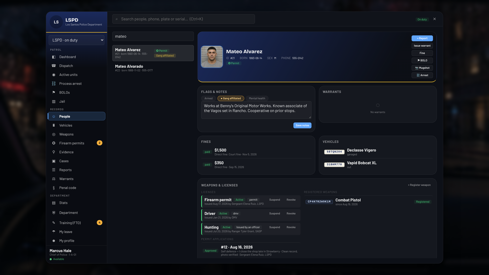
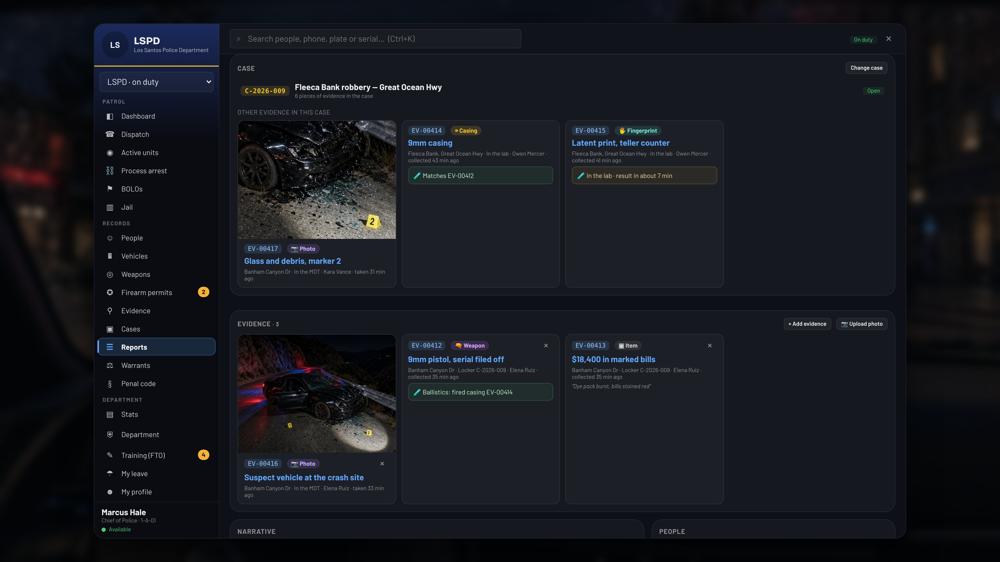
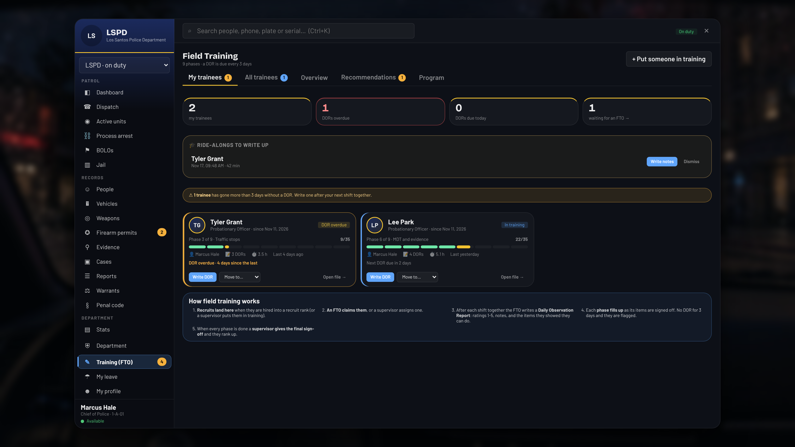
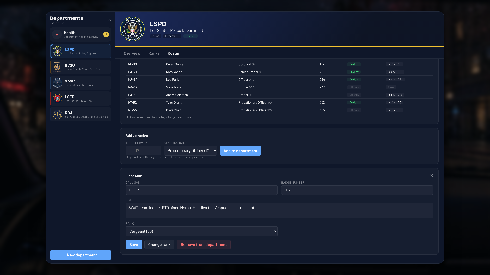
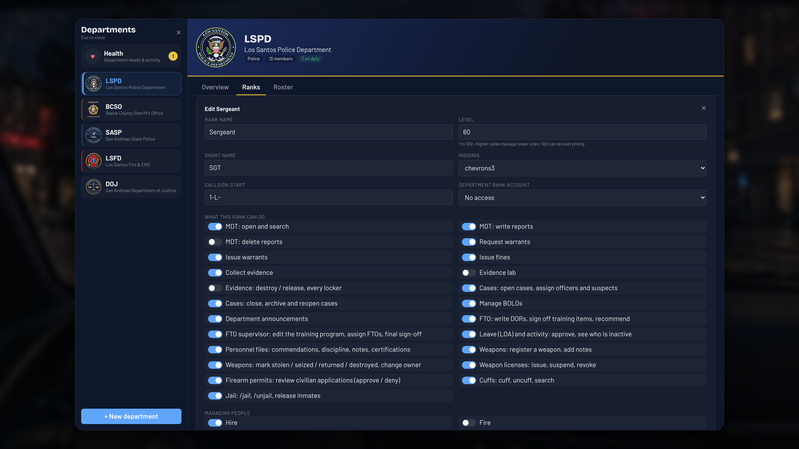
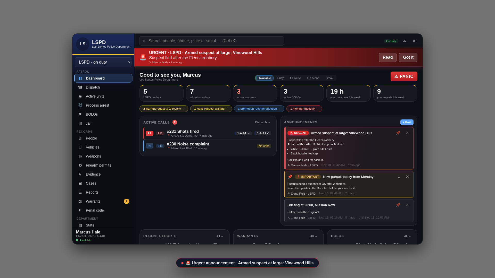
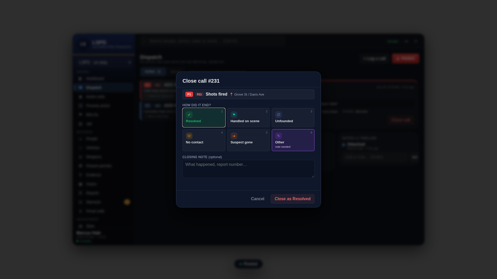

# es_mdt: emergency services for WHIP

One resource for police, sheriff, state police, rangers, EMS and the courts on a [WHIP](https://whipfx.net) FiveM server:

- **MDT** (`/mdt`, F6): dispatch, reports, warrants, BOLOs, fines, cases, evidence, weapons registry, firearm permits, a radar and plate reader, FTO, and personnel.
- **Departments** (`/departments`): departments, logos, ranks, permissions, rosters, duty time, leave, certifications, and department health.
- **DOJ** (`/doj` tablet, `/court` portal): court cases, hearings, judge-signed warrants, verdicts and sentences, bail, pleas, appeals, a clerk desk, the bar and attorneys, petitions, and records.

Optional companion: **es_jail** (handcuffs, breaking out, lockpicking, searching, and Bolingbroke jail with prison jobs). It is included in this repository. Any other jail script also works through the [jail bridge](#jail-integration-for-developers).

> **Status: public test release (2.0.4).** Read [What is tested](#what-is-tested) before using it on a live server.

## Screenshots

All screenshots use made-up test data.

| | |
|---|---|
|  MDT dashboard |  Person profile |
|  Criminal record |  Report |
|  Case with evidence |  Evidence on a report |
|  Officer profile |  Jail tab (no jail script: MDT record) |
|  FTO trainees |  FTO overview |
|  Trainee file |  Daily observation report |
|  Department health |  Roster |
|  Ranks and permissions |  DOJ court case |
|  DOJ fees, bail and fines |  Urgent announcement |
|  Closing a call: pick the outcome |  Call history with outcome badges |

## Requirements

| Resource | Needed | What for |
|---|---|---|
| [whip_core](https://github.com/WHIPFX) (WHIP 1.0+) | **required** | players, characters, jobs, money, items, the UI kit |
| [oxmysql](https://github.com/overextended/oxmysql) | **required** | database |
| es_jail (in this repo) or another jail script | optional | serving sentences. Without one, sentences are recorded in the MDT and their time is counted there |
| whip_evidence (LeSiiN) | optional | forensics. Evidence is uploaded to MDT cases. See [docs/whip_evidence_integration.md](docs/whip_evidence_integration.md) |
| whip_gunny | optional | weapons registry (gun serials) |

## Install

1. Copy the `[es]` folder into your `resources` folder. If you don't want es_jail, delete `[es]/es_jail`.
2. Add these lines to `server.cfg` after `ensure whip_core`:

   ```cfg
   ensure es_mdt
   # optional, after es_mdt:
   # ensure whip_evidence_assets
   # ensure whip_evidence
   ensure es_jail

   add_ace group.admin es_departments.admin allow   # create/delete departments in /departments
   add_ace group.admin es_doj.admin allow          # DOJ staff tools (view-as); /dojtest needs DevTools on
   ```

3. Start the server. Database tables are created and migrated automatically; there is no SQL to import. Each start also checks every es_mdt table against the columns the code needs and adds any that are missing (see [Database](#database)). On the first start, five departments are seeded (LSPD, BCSO, SASP, SA Park Rangers and DOJ) with ranks, permissions and logos. Each department is a WHIP job.
4. In game, an admin opens `/departments`, hires the first members (or sets a department owner) and adjusts ranks.

### Upgrading from es_departments / es_doj / es_mdt 1.x

Since 2.0.0 these are one resource. Your data stays where it is: same tables, same jobs, same permissions.

1. Stop the server. Move the old `es_departments`, `es_doj` and `es_mdt` folders **out of** `resources` (two folders with the same name break the server).
2. Put the new `es_mdt` in their place. Update es_jail to 1.1.1 or newer.
3. In `server.cfg`, remove `ensure es_departments` and `ensure es_doj`. Put `ensure es_mdt` where `ensure es_departments` was, before whip_evidence.
4. Start the server. On first start es_mdt takes over the old migration records and one-time setup marks, so nothing runs twice. Look for `took over` in the console.

The old names keep working: `exports.es_departments:*`, `exports.es_doj:*`, the `es_departments.admin` and `es_doj.admin` aces, and every command.

## Commands and keys

| Command | Key | Who | What |
|---|---|---|---|
| `/mdt` | F6 | department members with `mdt_view` | the MDT |
| `/departments` | | department heads, staff | departments, ranks, rosters, health |
| `/doj` | (none, set in config) | DOJ, licensed attorneys, police (read only) | DOJ tablet |
| `/court` | | everyone | public court portal: cases, filings, petitions |
| `/911`, `/311` | | everyone | emergency / non-emergency call to dispatch (street and position added; routed to law / EMS) |
| `/ems` | | everyone | medical call to EMS (off by default: `Config.Dispatch.medical = 'ems'`) |
| `/panic` | END | on-duty officers | panic: P1 OFFICER DOWN at your position; works while downed or dead |
| `/backup` | (none) | officers on a call | request backup at your position, linked to your call |
| `/permit` | | everyone | firearm permit application |
| `/mdtscale <percent>` | | everyone | display size of the MDT, Departments and DOJ pages, e.g. `/mdtscale 120`, `/mdtscale reset` |
| radar keys | (none) | police in a vehicle | radar and plate reader (Settings → Key Bindings → FiveM) |
| `/ftotest`, `/dojtest` | | staff, **DevTools only** | solo test tools |
| es_jail: `/jail`, `/unjail`, `/jailtime` | X = struggle | police / inmates | jail (es_jail) |

Players can change every key under GTA Settings → Key Bindings → FiveM.

**Display size.** Each player can make the MDT, Departments and DOJ pages smaller or larger with the **Aa** button in each page's header: a slider from 70% to 150% that resizes the pages as you drag, quick sizes, and a Reset. `/mdtscale <percent>` does the same from chat. The size is saved on the player's PC and used every time a page opens. The pages stay centred and on screen at every size. Server owners set the default and the range in `Config.UI` (`es_mdt/mdt/config.lua`).

## Dispatch: routing, panic, backup and alerts

All of this is in `Config.Dispatch` and `Config.Panic` (`es_mdt/mdt/config.lua`).

- **Routing:** each call kind goes to groups of department types (`law` = police, sheriff, state; `ems` = ems). Only those groups' on-duty units get the card, sound, blip and the call in their Dispatch tab. A group with no department on your server is skipped, so a server with no EMS department sends 911 and medical calls to law. Set `shared = true` to let every group see every call in its Dispatch tab. DOJ gets no calls.
- **Calls from players:** `/911 <message>` and `/311 <message>` (and `/ems` when `medical = 'ems'`) add the street and position automatically, and each player can call once per `cooldownSec` (30 s). They show up in chat suggestions.
- **Units on a call:** the call card and the MDT list every unit on the call (callsign, name, status) and update live.
- **Panic:** the **END** key (rebind under GTA Settings → Key Bindings → FiveM; `Config.Panic.key`), `/panic`, or the MDT's red button. On-duty officers only, with a `cooldown` (15 s). It files a P1 **OFFICER DOWN** call at the officer's position for law and EMS. It works while the officer is downed, injured or dead: nothing checks health, ragdoll or death, and WHIP lets the call through (`whileDead`).
- **Request backup:** the button on your call in the MDT, or `/backup` (bindable). It files a backup call at your position, linked to your call and sent where it went: P1 for a panic or P1 call, otherwise P2. The cooldown is 45 s.
- **Escalation:** a call nobody attached to goes up one priority every 5 minutes, up to P1. Panics are never escalated. The MDT updates quietly, with one soft re-alert to the units (`escalate.realert`).
- **Shots fired and vehicle theft:** automatic alerts from the game, each with its own `enabled`, `chance`, `cooldown` and `priority`. On-duty law, suppressed weapons and the Ammu-Nation ranges never trigger them, and repeat reports near an open call add a note to it rather than a new call. Other scripts can file them directly with `exports.es_mdt:ShotsFired(coords)` and `exports.es_mdt:VehicleTheft(coords, plate, model)`.

## Dispatch: closing calls, auto-close and announcements

**Closing a call.** The **Close call** button opens a picker: **Resolved**, **Handled on scene**, **Unfounded**, **No contact**, **Suspect gone** or **Other** (keys 1 to 6 pick one). A closing note is optional, except for **Other**, which needs one. The outcome, the note, who closed it and when are saved on the call. Each outcome has its own coloured badge in the Dispatch call list, on the call's page and in its timeline. Calls closed before 2.0.4, or closed by a script without an outcome, show **Closed**. Server owners can change the list, colours and icons in `Config.Dispatch.outcomes` (`note = 'required'` makes the note mandatory).

**Auto-close.** An active call is closed by itself once it is `Config.Dispatch.autoCloseMinutes` old (15 by default; 0 turns it off):

| The call | What happens |
|---|---|
| No unit on it | Closed at `autoCloseMinutes`. |
| A unit on it now | Left open: someone is working it. Set `autoCloseAttached = true` to close it too. Either way it is closed at `callTTLMin` (120 minutes), the hard cap. |
| A **panic** call with a unit on it | **Never** auto-closed. |

The outcome is **Auto-closed – no response** when no unit ever attached, or **Auto-closed (timeout)** when one did, even if they later left. Each has its own badge colour. Auto-close is **silent**: officers get no popup, sound, toast or notification. The call's blip and GPS route go, its call card leaves the queue, and the MDT's lists update quietly. Auto-closed calls are never deleted or hidden: they stay in the call history with their outcome and a note ("Closed automatically after 15 min").

**Blips and GPS.** When a call closes, by any path, its blip goes for everyone. Any player whose waypoint was set to that call (call card, **Set waypoint**, attaching, a partner, `/panicgps`) has it cleared, but only if the waypoint still points at the call. A waypoint they moved elsewhere stays. An officer who goes off duty, logs out or disconnects is taken off the calls they were on (with a note on each call), and their call blips, GPS route and call cards go.

**Announcements.** Posted from the Dashboard (**+ Post**, permission `announce`). Each one has a title, a message, an author and a time. Line breaks are kept, `**bold**` works, and lines starting with `- ` become a list. A live preview shows the result. The priority is **Normal**, **Important** (amber) or **Urgent** (red). An urgent announcement shows a red banner in the MDT and a red alert in game for everyone on duty in that department. An on-duty member who opens their MDT within `Config.Announcements.urgentFreshHours` (12) of an urgent announcement they have not seen also gets the banner, once.

## Configuration

Each part keeps its own config file:

| File | What is in it |
|---|---|
| `es_mdt/shared/suite.lua` | `EsSuite.DevTools`: staff test tools (`/dojtest`, `/ftotest`, MDT → Admin → Test data). **Off by default; keep it off on a live server.** |
| `es_mdt/departments/config.lua` | department types, the permission list, default ranks and their permissions, the first-start seed (`Config.Seed`), insignia, leave (LOA), FTO program, certifications, department health |
| `es_mdt/mdt/config.lua` | command and key, off-duty read only, fines, warrants and BOLOs, tablet props, firearm permits, weapons registry, unit statuses, report types and templates, penal code seed, dispatch (911/311 and call cards), display size (`Config.UI`), panic, mugshots, radar, cases, **jail bridge (`Config.Jail`)**, **whip_evidence bridge (`Config.WhipEvidence`)** |
| `es_mdt/doj/config.lua` | commands and key, who may view, warrants needing a judge, courthouse locations, case kinds and stages, hearings, filings, fees, bail, sentences, service, name changes, the bar, images |
| `es_jail/config.lua` | permissions, items, cuffs, breaking out, lockpicking, jail and prison, prison jobs, escape, test mode |

Every option is commented in its file. The penal code, report templates, department ranks and permissions are seeded from config on first start. After that you manage them in game.

### Permissions

Permissions are WHIP job permissions on each department's ranks, and you switch them per rank in `/departments`. Examples: `mdt_view`, `mdt_reports_write`, `warrants_request`, `warrants_issue`, `fines_issue`, `cases_create`, `cases_close`, `evidence_upload`, `bolo_manage`, `fto_train`, `personnel_manage`, `weapons_register`, `permits_manage`, `jail_cuff`, `jail_manage`, `doj_cases`, `doj_sign`, `doj_prosecute`, `doj_defend`, `doj_clerk`, `doj_bar` and `doj_seal`. The full list with descriptions is `Config.Permissions` in `departments/config.lua`.

## Jail integration for developers

The MDT (Process arrest → Send to jail) and the court (sentences) send prisoners through **one jail interface**, and any jail script can sit behind it.

`Config.Jail.provider` in `mdt/config.lua`:

| Value | Meaning |
|---|---|
| `'auto'` (default) | Uses the first jail found, in this order: a script that registered itself (the newest wins), then es_jail, then `Config.Jail.custom`, then none |
| `'es_jail'` | es_jail only |
| `'custom'` | `Config.Jail.custom` only |
| `'<resource>'` | the script that registered with that resource name |
| `'none'` | never jail; sentences are only recorded |

**With no jail script**, a sentence is still recorded in the MDT (table `es_mdt_jail_sentences`) and the event `es_mdt:jail:sent` fires. The Jail tab shows it, and the MDT counts the time itself: `Config.Jail.recordMinutesPerMonth` real minutes per month, 1 by default. An officer can release someone early from the Jail tab.

### Option 1: no code, use your script's exports

If your jail script has exports such as `JailPlayer(source, minutes, reason)`, describe them in `mdt/config.lua`:

```lua
Config.Jail = {
    provider = 'auto',
    custom = {
        resource = 'my_jail', label = 'My Jail',
        target = 'source',          -- what its exports take: 'source' (player must be online) or 'charId'
        timeUnit = 'minutes',       -- 'months' | 'minutes' | 'seconds'
        minutesPerMonth = 1,        -- one MDT month = this many minutes
        jail     = { export = 'JailPlayer',   args = { 'target', 'time', 'reason' } },
        release  = { export = 'UnjailPlayer', args = { 'target' } },      -- optional
        isJailed = { export = 'IsJailed',     args = { 'target' } },      -- optional
    },
}
```

The `args` names you can use are `target`, `charId`, `source`, `time` (in `timeUnit`), `months`, `minutes`, `seconds`, `reason`, `reportId`, `officerCharId` and `officerSource`.

### Option 2: register a provider from your jail script (server side)

```lua
-- in your jail resource, after es_mdt has started
exports.es_mdt:RegisterJailProvider({
    label = 'My Jail',
    -- required. info = { charId, source (nil if offline), months, reason, charges = { {code,title,count} }, reportId,
    --   courtCase, origin = 'mdt'|'court', byCharId, bySource }
    -- return true, or false + a reason the officer sees
    jail = function(info) return MyJail.put(info.source, info.months * 60, info.reason) end,
    release  = function(charId, info) return MyJail.free(charId) end,        -- optional: info = { byCharId, reason }
    isJailed = function(charId) return MyJail.isIn(charId), MyJail.secondsLeft(charId) end,   -- optional
    inmates  = function(recentDays) return MyJail.list() end,                 -- optional, rows for the Jail tab:
    -- { charId, status = 'serving'|'escaped'|'released', months, total, remaining (seconds), jailedAt, releasedAt, escapedAt, reason, online }
})
```

The provider is removed when your resource stops. `exports.es_mdt:UnregisterJailProvider()` removes it by hand, and `exports.es_mdt:GetJailProvider()` returns the name of the one in use.

### Tell the MDT what happened (server side)

```lua
-- someone was released (time served, a judge, an admin): closes the MDT record and serves "escape" warrants
exports.es_mdt:ReportJailRelease(charId, { reason = 'Time served', byCharId = nil })

-- someone escaped: the MDT record says so, an arrest warrant (+ BOLO) is issued and dispatch gets an alert
exports.es_mdt:ReportJailEscape(charId, {
    reason = 'Escaped from Bolingbroke', warrant = true, warrantDays = 7, bolo = true,
    alert = true, coords = GetEntityCoords(GetPlayerPed(src)), street = 'Bolingbroke Penitentiary', title = 'Prison break',
})
```

Prefer events? Use `TriggerEvent('es_mdt:jail:reportRelease', charId, info)` and `TriggerEvent('es_mdt:jail:reportEscape', charId, info)`. These are server events, which clients cannot send.

### Events es_mdt fires (server side)

| Event | Arguments |
|---|---|
| `es_mdt:jail:sent` | `info` (as above), `result = { ok, provider, why, recorded = true }`. Fires for every sentence, with or without a jail script |
| `es_mdt:jail:released` | `charId, { byCharId, reason, origin }` |
| `es_mdt:jail:escaped` | `charId, { reason, warrantId, origin }` |

### Calling the jail from other resources

`exports.es_mdt:JailSend(info)`, `exports.es_mdt:JailRelease(charId, byCharId, reason)` and `exports.es_mdt:JailIsJailed(charId)` all go through whichever provider is active.

## whip_evidence integration

With [whip_evidence](docs/whip_evidence_integration.md) installed, the MDT finds it by itself (`Config.WhipEvidence.enabled = 'auto'`). Set `Config.ApiResources = { 'es_mdt' }` in whip_evidence's config, and list your department job names in its `PoliceJobs`. The bridge provides:

- MDT case numbers as whip_evidence case IDs
- uploading bagged evidence and photos to a case
- lab results, the chain of custody and the timeline in the case
- closing and reopening the locker together with the MDT case

The details are in [docs/whip_evidence_integration.md](docs/whip_evidence_integration.md).

## For developers: exports

`exports.es_mdt:*` (also available under `exports.es_departments:*` and `exports.es_doj:*`):

- **Departments:** `HasPerm(source, perm)`, `GetDepartments()`, `GetDepartment(id)`, `GetPlayerDepartments(source)`, `GetActiveDepartment(source)`, `GetRoster(id)`, `GetOnDuty(id)`, `IsStaff(source)`, `GetLogo(id)`, `GetDutySeconds(charId)`, `HasCert(charId, cert)`, …
- **MDT:** `AddCall(call)`, `NotifyDispatch(title, message, coords, priority, sourceLabel)`, `CloseCall(id, outcome)`, `TestCall(kind, priority)` (see [Dispatch API](#dispatch-api)), `ShotsFired(coords, opts)`, `VehicleTheft(coords, plate, model, opts)` (2.0.6), `GetActiveWarrants(charId)`, `IssueWarrant(...)`, `EscapeWarrant(...)`, `ServeEscapeWarrants(charId)`, `HasActiveBolo(...)`, `CheckPlate(plate)`, `GetUnpaidFines(charId)`, `GetWeaponBySerial(serial)`, `GetPermitStatus(charId)`, `OpenTablet(source)`, …
- **DOJ:** `GetCourtMarks(charId)`, `GetRecordSummary(charId)`, `WarrantsNeedJudge()`, …

## Dispatch API

Any resource can put a call on the MDT dispatch board. Units on duty get the popup, a blip, and the call in the Dispatch tab, the same as a 911 call. The exports are **server side**. Each returns the call id, or `false, why`.

### `exports.es_mdt:AddCall(call)`

```lua
local callId = exports.es_mdt:AddCall({
    kind     = 'alert',                 -- '911' | '311' | 'alert' | 'officer' | 'panic' | 'medical' | 'shots' | 'theft' | 'backup'  (anything else: 'alert')
    -- groups = 'ems',                   -- 2.0.6, optional: who gets it ('law', 'ems' or { 'law', 'ems' }); default: Config.Dispatch.routing.kinds
    priority = 1,                       -- 1 (urgent) .. 3. Default: panic 1, 311 3, others 2
    title    = 'Alarm: Fleeca Hawick',  -- up to 120 characters. Default: the kind's name ('911 call', 'Alert', ...)
    message  = 'Silent alarm tripped',  -- up to 500
    street   = 'Hawick Ave',            -- up to 120
    coords   = GetEntityCoords(ped),    -- see the formats below; optional
    callerName = 'Bank system', callerPhone = '555-0100', callerCharId = nil,   -- optional
    blip = true, sprite = 280, color = 1, blipTime = 120,                        -- optional blip settings
    sourceLabel = 'bank_alarm',         -- optional, admins only (see below). Default: your resource's name
})
```

| Field | Also accepted as | Notes |
|---|---|---|
| `kind` | | `911`, `311`, `alert`, `officer`, `panic`, and since 2.0.6 `medical`, `shots`, `theft`, `backup`. Anything else becomes `alert`. The kind decides who gets the call (`Config.Dispatch.routing.kinds`). |
| `groups` | | 2.0.6: overrides the routing for this call: `'law'`, `'ems'` or `{ 'law', 'ems' }`. |
| `priority` | `prio` | 1 to 3, clamped. |
| `title` | | Up to 120 characters. With no title, the kind's name is used (`911 call`, `311 call`, `Panic`, `Officer call`, `Alert`). `name` is never used as the title. |
| `message` | `desc`, `description` | Up to 500 characters. |
| `street` | `location` | Up to 120 characters. |
| `coords` | `pos`, `position` | Optional. With no valid coords there is no blip. |
| `callerName` | `name`, `caller` | Up to 80 characters. |
| `callerPhone` | `phone` | Up to 20 characters. |
| `callerCharId` | `charId` | A number. |
| `blip` | | `false`: no map blip. |
| `sprite`, `color` | | Blip sprite and color. Default: `Config.Dispatch.blip`. |
| `blipTime` | | Seconds the blip stays, 5 to 1800. Default: `Config.Dispatch.blip.seconds`. |
| `deptId` | | Optional department id stored with the call. |
| `sourceLabel` | `source`, `from`, `resource` | A text label, up to 40 characters. With none, the name of the resource that called the export. **Admins only**: see below. |

Strings are trimmed, control characters are removed (new lines and tabs are kept), and the lengths above are applied.

**Where a call came from is for admins only.** Officers never see which script filed a call: the source label is not sent to players, and it is not on the call card or in the MDT. Server admins see it in the server console (`[es_mdt] call #42 (alert, P1) filed by bank_alarm`) and in the `sourceLabel` column of `es_mdt_calls`. The 911/311 phone calls, the panic button and es_mdt's own calls have no label.

**Coordinate formats.** All of these work: `vector3(x, y, z)`, `vector4(x, y, z, h)` (the heading is ignored), `{ x = 1.0, y = 2.0, z = 3.0 }` and `{ 1.0, 2.0, 3.0 }`. `z` is optional. Coordinates that are not numbers, or that are outside the map (more than 20000 from the centre), are dropped.

### `exports.es_mdt:NotifyDispatch(title, message, coords, priority, sourceLabel, extra)`

The short form: an `alert` call.

```lua
exports.es_mdt:NotifyDispatch('Store robbery', '24/7 on Innocence Blvd', vector3(25.7, -1347.3, 29.5), 1)
```

`coords` and `priority` are optional (priority defaults to 2). The fifth argument is optional:

- a **string** is the admin-only source label, and an optional sixth argument is a table of any other `AddCall` fields: `NotifyDispatch('Store robbery', '…', coords, 1, 'my_robbery', { street = 'Innocence Blvd' })`
- a **table** is those other fields, as in 2.0.1: `NotifyDispatch('Store robbery', '…', coords, 1, { street = 'Innocence Blvd', kind = '911' })`

### `exports.es_mdt:CloseCall(callId, outcome, note)`

Closes an active call, the same as the MDT's Close call button: the units on it are freed, its map blip goes for everyone at once, every on-duty unit's call card shows it closed, and GPS routes to it are cleared. `outcome` is free text (up to 40 characters) and defaults to `Closed`. Returns `true`, or `false, why`.

**Blips.** A call's map blip is removed as soon as the call closes, however it closes: the Close call button, `CloseCall`, or auto-close (see [Dispatch: closing calls, auto-close and announcements](#dispatch-closing-calls-auto-close-and-announcements)). Closing a panic call also removes the PANIC blip. Otherwise the blip goes after its `blipTime`. Call and panic blips are only on the maps of officers on duty: going off duty takes them off, and coming on duty while a blip is still up adds it.

### Test calls: `/mdttestcall`

| Command | What |
|---|---|
| `/mdttestcall [kind] [priority]` | A test call, titled `TEST · <kind>`, near you (from the server console: at Legion Square). `kind` is `911`, `311`, `alert` (default), `officer` or `panic` (a panic test only files the call; it does not press anyone's panic button). |
| `/mdttestcall clear` | Closes and deletes every test call. |

For the server console and staff only (WHIP permission `es_mdt.departments.manage`, the `es_departments.admin` ace, or WHIP developer mode). Test calls are labeled `test` (admins only). `exports.es_mdt:TestCall(kind, priority)` does the same from a server script.

### From client scripts: the `es_mdt:server:externalCall` net event

A client script cannot call server exports. It can send:

```lua
TriggerServerEvent('es_mdt:server:externalCall', { title = 'Shots fired', message = 'Near the docks', coords = GetEntityCoords(PlayerPedId()), priority = 1 })
```

This event is guarded, because any player can send any net event:

- **Who:** a player on duty in a department, or a player whose WHIP job is listed in `Config.Dispatch.external.jobs`. Anyone else is refused.
- **Rate limit:** one call per player every `cooldownSec` (10 s), and at most `perMinute` (5) a minute.
- **No panics:** `kind = 'panic'` is refused (the panic button files panics). The allowed kinds are in `Config.Dispatch.external.kinds`.
- **The caller is the sender:** the caller's name, phone and character come from the server, never from the data. `sprite`, `color`, `blipTime` and `deptId` are ignored.
- **Clamped:** only `kind`, `priority`, `title`, `message`, `street`, `coords` and `blip` are read, with the limits above. With no valid coords, the sender's own position is used.
- **Source:** labeled `external:client` on the server (admins only, see above). Any label in the data is ignored.
- A refused call shows the player the reason. Every accepted call is printed in the server console.

```lua
-- mdt/config.lua
Config.Dispatch.external = {
    enabled     = true,     -- false: the event is not registered at all (server exports only)
    onDuty      = true,     -- players on duty in any department may send it
    jobs        = {},       -- and players in these WHIP jobs, e.g. { 'tow', 'security' }
    kinds       = { '911', '311', 'alert', 'officer' },
    cooldownSec = 10,
    perMinute   = 5,
}
```

For calls from members of the public (a store clerk, a bank alarm), use the server exports from your server script. The event is not for that.

## Database

es_mdt creates and updates its own tables, so there is no SQL to import. Each table's `CREATE TABLE` statement in the code is the source of truth for its columns and keys. On every start:

1. WHIP's `EnsureTable` creates any missing table and runs the table's migrations that haven't run yet. The migrations are recorded in `schema_migrations`.
2. **The schema self-check** (2.0.5, `server/schema.lua`) compares each table with its `CREATE TABLE` in `information_schema` and adds any missing column or key. It never drops, renames or changes anything that is already there, and it doesn't add foreign keys. So a database that missed a migration, for any reason, is completed at the next start.

Each column or key it adds is logged as `[es_mdt] schema: added missing column ...`. If it cannot add one, the server console shows a red **SCHEMA ERROR** block with the SQL to run by hand, and WHIP lists it as a start problem. About 20 seconds after start, `[es_mdt] schema check: 68 tables OK` confirms everything is in place.

## How it is built

2.0.0 merged three resources into one, and each part still runs on its own. Each part's Lua runs with its own globals (`shared/env.lua`): its own `Config` and helpers, while the exports are shared. Each part's page runs in its own frame of one NUI page (`html/index.html` and `html/shell.js`), so the MDT, Departments and the DOJ tablet can be open on top of each other.

## What is tested

- **Running on a live server (as separate resources, before the merge):** MDT dispatch, reports, warrants, fines, cases, FTO, personnel, Departments, the whip_evidence bridge, es_jail.
- **Tested for 2.0.6:** in Lua tests: routing for every call kind (including a server with no EMS department, and `shared`), the medical line, chat suggestions, the unit list, the panic key mapping (END, the old mapping kept) and pressing it while dead, at 0 health and ragdolled, the panic callback being `whileDead` with no death checks, the panic cooldown and on-duty rule, OFFICER DOWN going to law and EMS, backup (linking, priority, cooldown, while downed), escalation (never a panic, never past P1, never a call with a unit), and shots and theft alerts (toggles, chance, cooldowns, law and suppressed exemptions, area merging, the exports). In browser tests: the call card's unit list, escalated, officer-down and backup cards, and the MDT call page with units and Request backup. On a live server: the calls filed and routed, and the database migration. Not tested in game with a real player: the END key itself, pressing it while actually downed, and the game-side shots and theft detection.
- **Tested for 2.0.5:** the schema self-check against a real MariaDB database, using whip_core's own `EnsureTable` and migration code: a fresh database, an old 1.x database with rows in it, and a broken 2.0.4 fresh install all end up with every column and key of all 68 tables. The 2.0.4 errors were reproduced and then repaired. Extra columns, keys and rows were left untouched. A fix that fails gives a loud error and a start problem, and is repaired at the next start. A second start does nothing.
- **Tested for 2.0.4:** in Lua tests: the outcome list and its checks (Other needs a note), `everAttached`, auto-close for every case in the table above (with no notification of any kind sent), the off-duty clean-up and duty blips, announcement priority, and the client's GPS clean-up (a waypoint moved elsewhere stays, auto-close says nothing). In browser tests: the outcome picker, the badges, the announcement form and preview, and the urgent banner on open. On a live server: the database migrations, a test call closed with an outcome, and test calls auto-closed with a short timeout (outcomes, saved rows, no notification sent).
- **Tested for 2.0.3:** source labels (defaults, the `NotifyDispatch` forms, never sent to players), `/mdttestcall` and `TestCall`, and closing calls with their blips, in Lua tests; and on a live server, a test call from the console stored with its label, then closed and removed.
- **Tested for 2.0.2:** the display size in browser tests at 70%, 100% and 150% on 1920×1080 and 2560×1440: the pages fit and stay centred, and clicks, the search list, dialogs and the photo viewer line up; the slider, quick sizes, Reset, Esc and a saved size on reload; and `/mdtscale`.
- **Tested for 2.0.1:** the dispatch exports on a live server (calls filed through `NotifyDispatch` and the old `AddCall` form).
- **Tested for 2.0.0:** Lua syntax; every file loads in order with each part's globals kept apart and the old export names working; and browser tests of the one-page UI (every part opens, messages and clicks reach the right part, no JS errors).
- **Not yet tested on a live server:** the DOJ 1.1.0 features (attorneys and the bar, fees, bail, appeals), firearm permits, the jail bridge with a third-party jail script, and a full fresh install in game (the empty-database schema is covered by the 2.0.5 database test).

Please report problems with your server log (F8 and the server console).

## License

MIT. See [LICENSE](LICENSE).
