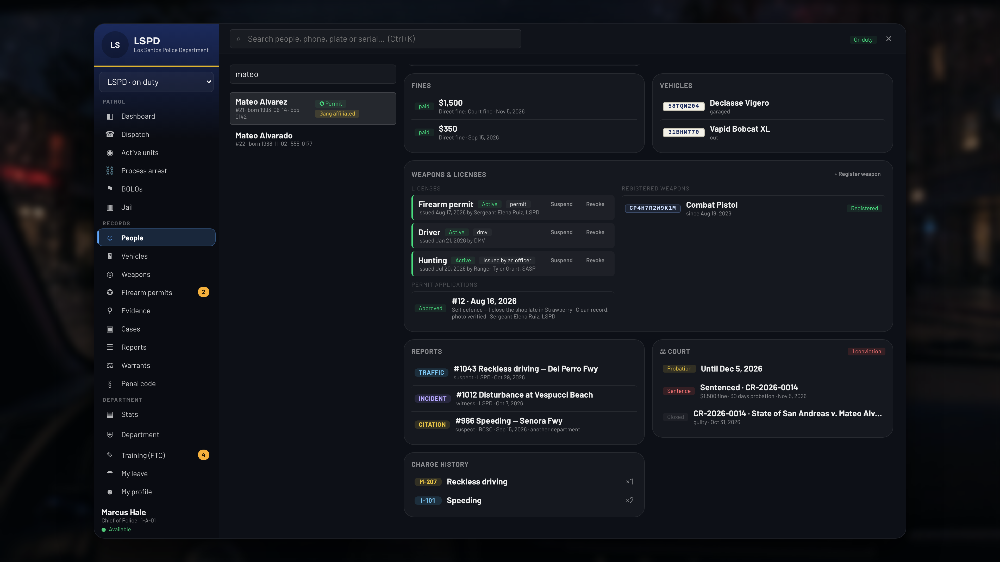
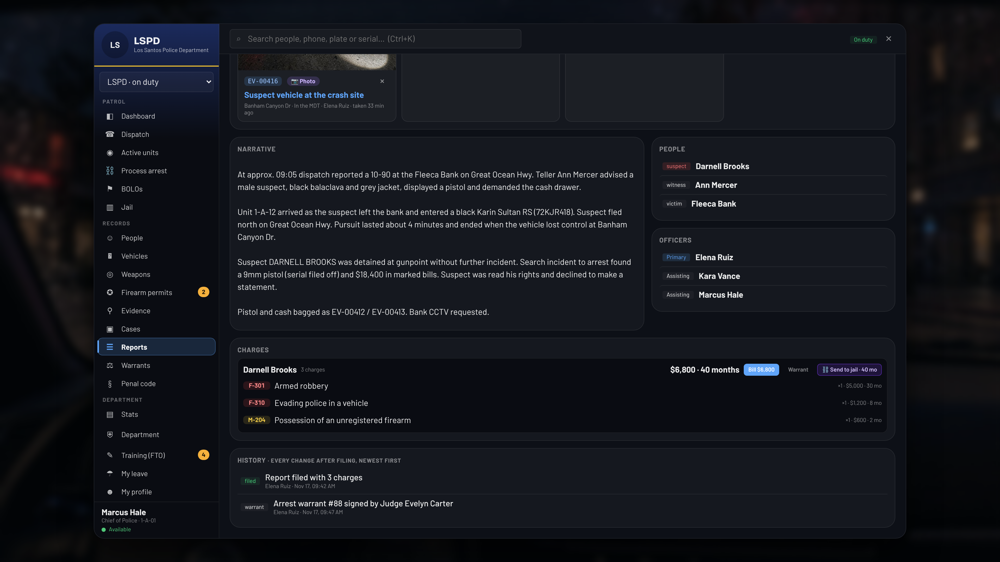
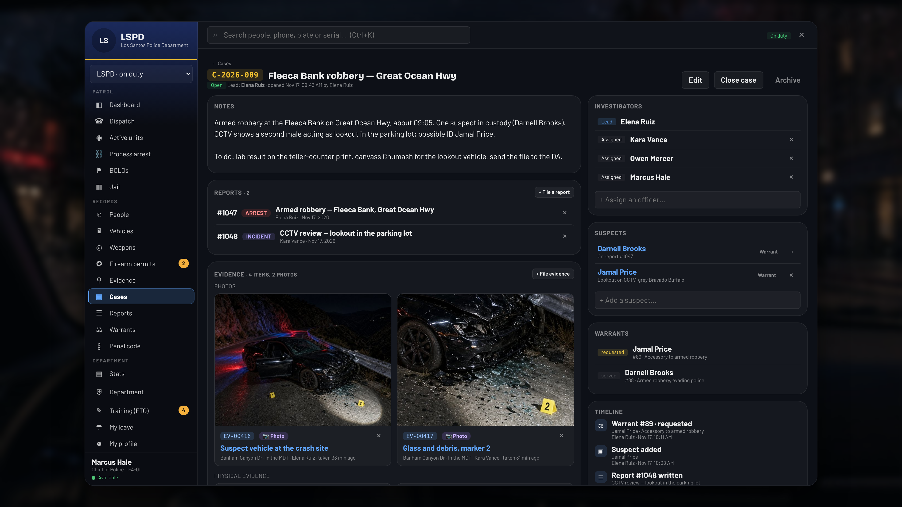
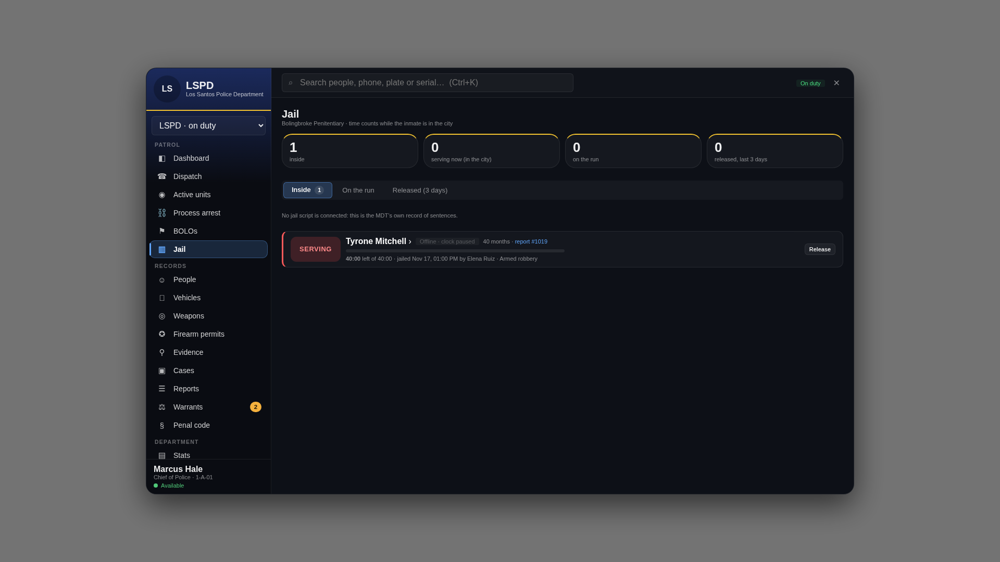
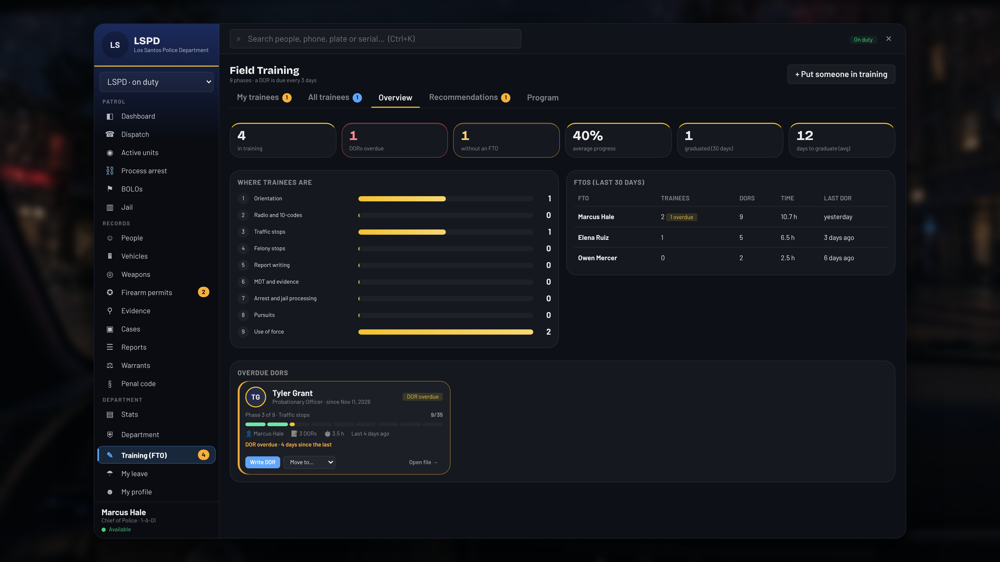
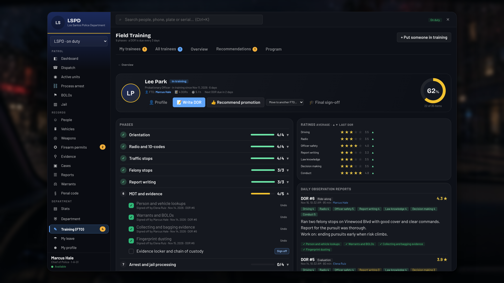
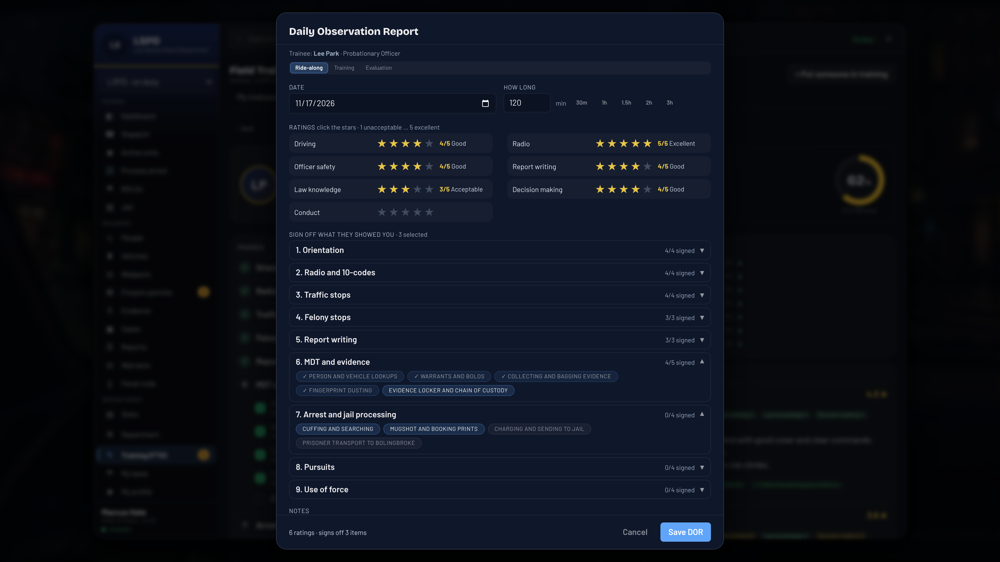
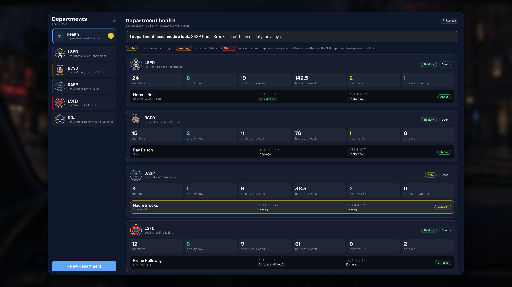
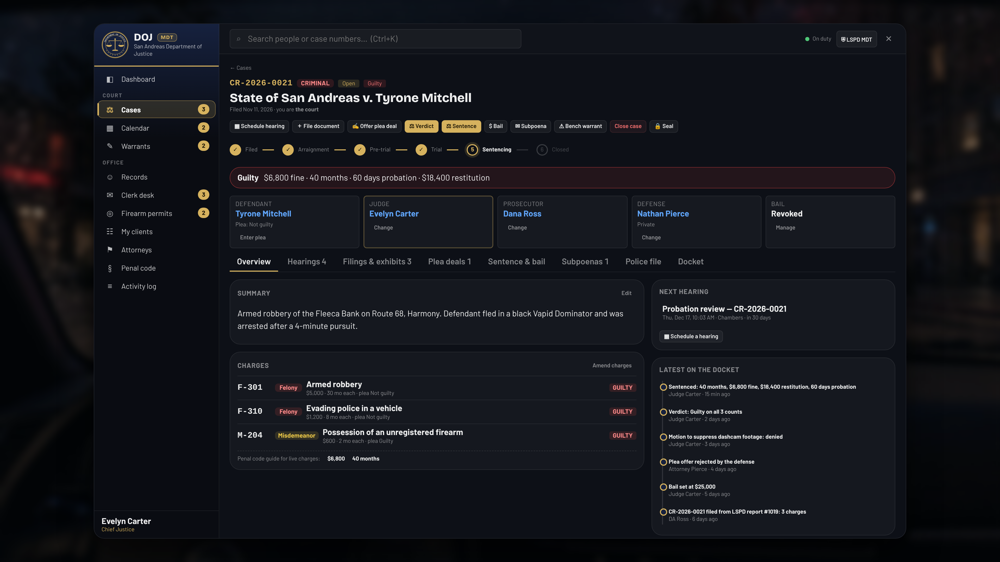

# es_mdt: emergency services for WHIP

One resource for police, sheriff, state police, rangers, EMS and the courts on a [WHIP](https://whipfx.net) FiveM server:

- **MDT** (`/mdt`, F6): dispatch, reports, warrants, BOLOs, fines, cases, evidence, weapons registry, firearm permits, a radar and plate reader, FTO, and personnel.
- **Departments** (`/departments`): departments, logos, ranks, permissions, rosters, duty time, leave, certifications, and department health.
- **DOJ** (`/doj` tablet, `/court` portal): court cases, hearings, judge-signed warrants, verdicts and sentences, bail, pleas, appeals, a clerk desk, the bar and attorneys, petitions, and records.

Optional companion: **es_jail** (handcuffs, breaking out, lockpicking, searching, and Bolingbroke jail with prison jobs). It is included in this repository. Any other jail script also works through the [jail bridge](#jail-integration-for-developers).

> **Status: public test release (2.0.0).** Read [What is tested](#what-is-tested) before using it on a live server.

## Screenshots

All screenshots use made-up test data.

| | |
|---|---|
|  MDT dashboard |  Person profile |
|  Criminal record |  Report |
|  Case with evidence |  Evidence on a report |
|  Officer profile |  Jail tab (no jail script: MDT record) |
|  FTO trainees |  FTO overview |
|  Trainee file |  Daily observation report |
|  Department health |  Roster |
|  Ranks and permissions |  DOJ court case |
|  DOJ fees, bail and fines | |

## Requirements

| Resource | Needed | What for |
|---|---|---|
| [whip_core](https://github.com/WHIPFX) (WHIP 1.0+) | **required** | players, characters, jobs, money, items, the UI kit |
| [oxmysql](https://github.com/overextended/oxmysql) | **required** | database |
| es_jail (in this repo) or another jail script | optional | serving sentences. Without one, sentences are recorded in the MDT and their time is counted there |
| whip_evidence (LeSiiN) | optional | forensics. Evidence is uploaded to MDT cases. See [docs/whip_evidence_integration.md](docs/whip_evidence_integration.md) |
| whip_gunny | optional | weapons registry (gun serials) |

## Install

1. Copy the `[es]` folder into your `resources` folder. If you don't want es_jail, delete `[es]/es_jail`.
2. Add these lines to `server.cfg` after `ensure whip_core`:

   ```cfg
   ensure es_mdt
   # optional, after es_mdt:
   # ensure whip_evidence_assets
   # ensure whip_evidence
   ensure es_jail

   add_ace group.admin es_departments.admin allow   # create/delete departments in /departments
   add_ace group.admin es_doj.admin allow          # DOJ staff tools (view-as); /dojtest needs DevTools on
   ```

3. Start the server. Database tables are created and migrated automatically; there is no SQL to import. On the first start, five departments are seeded (LSPD, BCSO, SASP, SA Park Rangers and DOJ) with ranks, permissions and logos. Each department is a WHIP job.
4. In game, an admin opens `/departments`, hires the first members (or sets a department owner) and adjusts ranks.

### Upgrading from es_departments / es_doj / es_mdt 1.x

Since 2.0.0 these are one resource. Your data stays where it is: same tables, same jobs, same permissions.

1. Stop the server. Move the old `es_departments`, `es_doj` and `es_mdt` folders **out of** `resources` (two folders with the same name break the server).
2. Put the new `es_mdt` in their place. Update es_jail to 1.1.1 or newer.
3. In `server.cfg`, remove `ensure es_departments` and `ensure es_doj`. Put `ensure es_mdt` where `ensure es_departments` was, before whip_evidence.
4. Start the server. On first start es_mdt takes over the old migration records and one-time setup marks, so nothing runs twice. Look for `took over` in the console.

The old names keep working: `exports.es_departments:*`, `exports.es_doj:*`, the `es_departments.admin` and `es_doj.admin` aces, and every command.

## Commands and keys

| Command | Key | Who | What |
|---|---|---|---|
| `/mdt` | F6 | department members with `mdt_view` | the MDT |
| `/departments` | | department heads, staff | departments, ranks, rosters, health |
| `/doj` | (none, set in config) | DOJ, licensed attorneys, police (read only) | DOJ tablet |
| `/court` | | everyone | public court portal: cases, filings, petitions |
| `/911`, `/311` | | everyone | emergency / non-emergency call to dispatch |
| `/panic` | (none) | on-duty police | panic button |
| `/permit` | | everyone | firearm permit application |
| radar keys | (none) | police in a vehicle | radar and plate reader (Settings → Key Bindings → FiveM) |
| `/ftotest`, `/dojtest` | | staff, **DevTools only** | solo test tools |
| es_jail: `/jail`, `/unjail`, `/jailtime` | X = struggle | police / inmates | jail (es_jail) |

Players can change every key under GTA Settings → Key Bindings → FiveM.

## Configuration

Each part keeps its own config file:

| File | What is in it |
|---|---|
| `es_mdt/shared/suite.lua` | `EsSuite.DevTools`: staff test tools (`/dojtest`, `/ftotest`, MDT → Admin → Test data). **Off by default; keep it off on a live server.** |
| `es_mdt/departments/config.lua` | department types, the permission list, default ranks and their permissions, the first-start seed (`Config.Seed`), insignia, leave (LOA), FTO program, certifications, department health |
| `es_mdt/mdt/config.lua` | command and key, off-duty read only, fines, warrants and BOLOs, tablet props, firearm permits, weapons registry, unit statuses, report types and templates, penal code seed, dispatch (911/311 and call cards), panic, mugshots, radar, cases, **jail bridge (`Config.Jail`)**, **whip_evidence bridge (`Config.WhipEvidence`)** |
| `es_mdt/doj/config.lua` | commands and key, who may view, warrants needing a judge, courthouse locations, case kinds and stages, hearings, filings, fees, bail, sentences, service, name changes, the bar, images |
| `es_jail/config.lua` | permissions, items, cuffs, breaking out, lockpicking, jail and prison, prison jobs, escape, test mode |

Every option is commented in its file. The penal code, report templates, department ranks and permissions are seeded from config on first start. After that you manage them in game.

### Permissions

Permissions are WHIP job permissions on each department's ranks, and you switch them per rank in `/departments`. Examples: `mdt_view`, `mdt_reports_write`, `warrants_request`, `warrants_issue`, `fines_issue`, `cases_create`, `cases_close`, `evidence_upload`, `bolo_manage`, `fto_train`, `personnel_manage`, `weapons_register`, `permits_manage`, `jail_cuff`, `jail_manage`, `doj_cases`, `doj_sign`, `doj_prosecute`, `doj_defend`, `doj_clerk`, `doj_bar` and `doj_seal`. The full list with descriptions is `Config.Permissions` in `departments/config.lua`.

## Jail integration for developers

The MDT (Process arrest → Send to jail) and the court (sentences) send prisoners through **one jail interface**, and any jail script can sit behind it.

`Config.Jail.provider` in `mdt/config.lua`:

| Value | Meaning |
|---|---|
| `'auto'` (default) | Uses the first jail found, in this order: a script that registered itself (the newest wins), then es_jail, then `Config.Jail.custom`, then none |
| `'es_jail'` | es_jail only |
| `'custom'` | `Config.Jail.custom` only |
| `'<resource>'` | the script that registered with that resource name |
| `'none'` | never jail; sentences are only recorded |

**With no jail script**, a sentence is still recorded in the MDT (table `es_mdt_jail_sentences`) and the event `es_mdt:jail:sent` fires. The Jail tab shows it, and the MDT counts the time itself: `Config.Jail.recordMinutesPerMonth` real minutes per month, 1 by default. An officer can release someone early from the Jail tab.

### Option 1: no code, use your script's exports

If your jail script has exports such as `JailPlayer(source, minutes, reason)`, describe them in `mdt/config.lua`:

```lua
Config.Jail = {
    provider = 'auto',
    custom = {
        resource = 'my_jail', label = 'My Jail',
        target = 'source',          -- what its exports take: 'source' (player must be online) or 'charId'
        timeUnit = 'minutes',       -- 'months' | 'minutes' | 'seconds'
        minutesPerMonth = 1,        -- one MDT month = this many minutes
        jail     = { export = 'JailPlayer',   args = { 'target', 'time', 'reason' } },
        release  = { export = 'UnjailPlayer', args = { 'target' } },      -- optional
        isJailed = { export = 'IsJailed',     args = { 'target' } },      -- optional
    },
}
```

The `args` names you can use are `target`, `charId`, `source`, `time` (in `timeUnit`), `months`, `minutes`, `seconds`, `reason`, `reportId`, `officerCharId` and `officerSource`.

### Option 2: register a provider from your jail script (server side)

```lua
-- in your jail resource, after es_mdt has started
exports.es_mdt:RegisterJailProvider({
    label = 'My Jail',
    -- required. info = { charId, source (nil if offline), months, reason, charges = { {code,title,count} }, reportId,
    --   courtCase, origin = 'mdt'|'court', byCharId, bySource }
    -- return true, or false + a reason the officer sees
    jail = function(info) return MyJail.put(info.source, info.months * 60, info.reason) end,
    release  = function(charId, info) return MyJail.free(charId) end,        -- optional: info = { byCharId, reason }
    isJailed = function(charId) return MyJail.isIn(charId), MyJail.secondsLeft(charId) end,   -- optional
    inmates  = function(recentDays) return MyJail.list() end,                 -- optional, rows for the Jail tab:
    -- { charId, status = 'serving'|'escaped'|'released', months, total, remaining (seconds), jailedAt, releasedAt, escapedAt, reason, online }
})
```

The provider is removed when your resource stops. `exports.es_mdt:UnregisterJailProvider()` removes it by hand, and `exports.es_mdt:GetJailProvider()` returns the name of the one in use.

### Tell the MDT what happened (server side)

```lua
-- someone was released (time served, a judge, an admin): closes the MDT record and serves "escape" warrants
exports.es_mdt:ReportJailRelease(charId, { reason = 'Time served', byCharId = nil })

-- someone escaped: the MDT record says so, an arrest warrant (+ BOLO) is issued and dispatch gets an alert
exports.es_mdt:ReportJailEscape(charId, {
    reason = 'Escaped from Bolingbroke', warrant = true, warrantDays = 7, bolo = true,
    alert = true, coords = GetEntityCoords(GetPlayerPed(src)), street = 'Bolingbroke Penitentiary', title = 'Prison break',
})
```

Prefer events? Use `TriggerEvent('es_mdt:jail:reportRelease', charId, info)` and `TriggerEvent('es_mdt:jail:reportEscape', charId, info)`. These are server events, which clients cannot send.

### Events es_mdt fires (server side)

| Event | Arguments |
|---|---|
| `es_mdt:jail:sent` | `info` (as above), `result = { ok, provider, why, recorded = true }`. Fires for every sentence, with or without a jail script |
| `es_mdt:jail:released` | `charId, { byCharId, reason, origin }` |
| `es_mdt:jail:escaped` | `charId, { reason, warrantId, origin }` |

### Calling the jail from other resources

`exports.es_mdt:JailSend(info)`, `exports.es_mdt:JailRelease(charId, byCharId, reason)` and `exports.es_mdt:JailIsJailed(charId)` all go through whichever provider is active.

## whip_evidence integration

With [whip_evidence](docs/whip_evidence_integration.md) installed, the MDT finds it by itself (`Config.WhipEvidence.enabled = 'auto'`). Set `Config.ApiResources = { 'es_mdt' }` in whip_evidence's config, and list your department job names in its `PoliceJobs`. The bridge provides:

- MDT case numbers as whip_evidence case IDs
- uploading bagged evidence and photos to a case
- lab results, the chain of custody and the timeline in the case
- closing and reopening the locker together with the MDT case

The details are in [docs/whip_evidence_integration.md](docs/whip_evidence_integration.md).

## For developers: exports

`exports.es_mdt:*` (also available under `exports.es_departments:*` and `exports.es_doj:*`):

- **Departments:** `HasPerm(source, perm)`, `GetDepartments()`, `GetDepartment(id)`, `GetPlayerDepartments(source)`, `GetActiveDepartment(source)`, `GetRoster(id)`, `GetOnDuty(id)`, `IsStaff(source)`, `GetLogo(id)`, `GetDutySeconds(charId)`, `HasCert(charId, cert)`, …
- **MDT:** `AddCall(call)`, `GetActiveWarrants(charId)`, `IssueWarrant(...)`, `EscapeWarrant(...)`, `ServeEscapeWarrants(charId)`, `HasActiveBolo(...)`, `CheckPlate(plate)`, `GetUnpaidFines(charId)`, `GetWeaponBySerial(serial)`, `GetPermitStatus(charId)`, `OpenTablet(source)`, …
- **DOJ:** `GetCourtMarks(charId)`, `GetRecordSummary(charId)`, `WarrantsNeedJudge()`, …

## How it is built

2.0.0 merged three resources into one, and each part still runs on its own. Each part's Lua runs with its own globals (`shared/env.lua`): its own `Config` and helpers, while the exports are shared. Each part's page runs in its own frame of one NUI page (`html/index.html` and `html/shell.js`), so the MDT, Departments and the DOJ tablet can be open on top of each other.

## What is tested

- **Running on a live server (as separate resources, before the merge):** MDT dispatch, reports, warrants, fines, cases, FTO, personnel, Departments, the whip_evidence bridge, es_jail.
- **Tested for 2.0.0:** Lua syntax; every file loads in order with each part's globals kept apart and the old export names working; and browser tests of the one-page UI (every part opens, messages and clicks reach the right part, no JS errors).
- **Not yet tested on a live server:** the DOJ 1.1.0 features (attorneys and the bar, fees, bail, appeals), firearm permits, the jail bridge with a third-party jail script, and a fresh install on an empty database.

Please report problems with your server log (F8 and the server console).

## License

MIT. See [LICENSE](LICENSE).
